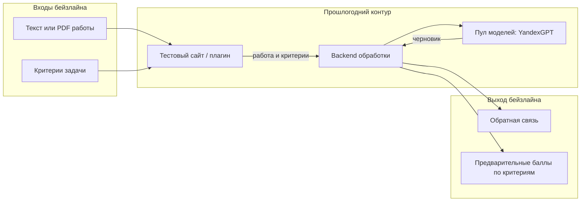
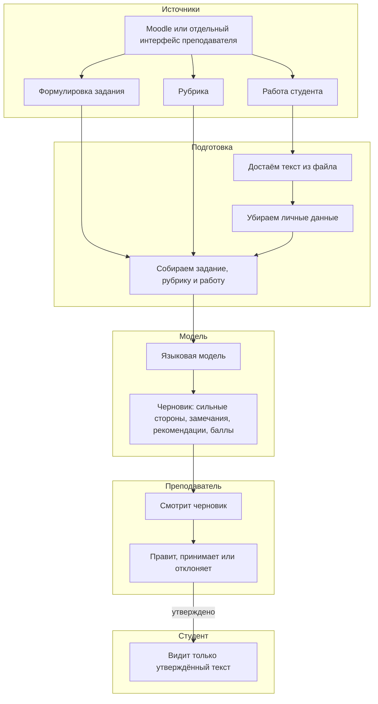

# ML System Design Doc - [RU]

## Дизайн ML системы - Feedback Assistant MVP 1

Документ заполнен по шаблону Reliable ML для проекта ИТМО: ИИ-ассистент обратной связи по работам студентов в Moodle.

---

### 1. Цели и предпосылки

#### 1.1. Зачем идем в разработку продукта?

**Постановка бизнес задачи**

Задача — разработать помощника, который помогает преподавателю писать содержательную обратную связь по письменным работам студентов. Данная система поможет проверить эссе, отчёты, кейсы и ответы на открытые вопросы быстрее, чем если разбирать каждую работу полностью вручную.

Сейчас преподаватель часто не успевает дать каждому студенту развёрнутый комментарий. Например, при 5 группах и примерно 100 студентах на написание развивающей обратной связи просто не хватает времени. В итоге студент либо ждёт слишком долго, либо получает короткий отзыв вроде «хорошо» или «надо доработать».

Цель продукта — не заменить преподавателя. Система готовит черновик, а преподаватель его проверяет, правит и только потом отправляет студенту.

**Почему станет лучше от использования ML**

Обычными правилами эту задачу решить нельзя. Чтобы понять, раскрыта ли тема, есть ли аргументы и соответствует ли текст рубрике, нужно читать работу целиком. Модель как раз умеет сопоставить задание, критерии и текст студента.

На выходе преподаватель получает черновик:

- сильные стороны работы;
- замечания по каждому критерию;
- рекомендации и следующий шаг;
- предварительные баллы по критериям.

Это быстрее, чем писать отзыв с нуля. При этом модель не ставит итоговую оценку сама и не отправляет текст студенту без подтверждения преподавателя.

**Что будем считать успехом итерации**

Итерация будет успешной, если преподаватель сможет загрузить задание, рубрику и работу студента, получить черновик за разумное время и доработать его, а не переписывать заново.

Также успехом считаем, что в модель не уходят фамилии и другие личные данные, а оценка не появляется у студента, пока преподаватель сам её не подтвердит.

В прошлом году на похожем прототипе уже получили MAE 1.66 и F1 0.86 по критериям рубрики. Для нас это ориентир качества бейзлайна. Главное в этой итерации всё же не «идеальная оценка», а полезный черновик, который преподавателю не стыдно править.

#### 1.2. Бизнес-требования и ограничения

**Краткое описание бизнес-требований**

Требования взяты из описания проекта Talent Track и из презентации прошлогоднего прототипа «ИИ-ассистент для Moodle».

Система должна разбирать письменную работу по формулировке задания и рубрике. Черновик обратной связи должен быть понятным: сильные стороны, замечания по критериям, рекомендации и следующий шаг. Если получится, комментарий лучше привязывать к конкретному фрагменту текста.

Преподаватель должен иметь возможность отредактировать черновик, принять его или отклонить. Система может предложить проект баллов, но не имеет права сама выставлять итоговую оценку в Moodle.

На вход подаются текст и PDF, по возможности также DOCX. Работать нужно в первую очередь на русском языке, английский желателен. Все решения, которые увидит студент, подтверждает преподаватель.

**Бизнес-ограничения**

В языковую модель нельзя передавать персональные данные студентов. Для разработки используются только обезличенные работы, тестовые задания и рубрики.

Система не является автогрейдером. Ответственность за формулировки и оценку остаётся на преподавателе.

Есть наработки прошлого года, и их нужно использовать. Команда небольшая, это учебный проект, а не промышленный запуск на весь университет.

**Что ожидаем от этой итерации**

В этой итерации нужен рабочий прототип, а не плагин, сразу внедрённый во все курсы ИТМО.

Ожидаем один понятный сценарий: преподаватель загружает работу, получает черновик и утверждает его. Если полная интеграция с Moodle не успеет, пилот идёт через отдельный интерфейс.

**Как модель встроится в процесс**

Сейчас студент сдаёт работу в Moodle, преподаватель читает файл, пишет комментарий и ставит оценку. Студент видит результат с задержкой.

В пилоте студент сдаёт работу как обычно. Преподаватель открывает задание, рубрику и файл. Система показывает черновик только преподавателю. Он правит текст, принимает или отклоняет его и при необходимости меняет баллы. Студент видит только утверждённый комментарий. Оценка в журнал попадает только если преподаватель сам её отправит.

В прошлогоднем прототипе на схеме студент сразу получал обратную связь с сайта. Сейчас получатель черновика — преподаватель. Это важное отличие.

**Что считаем успешным пилотом**

Пилот успешен, если на демо-наборе система стабильно собирает черновик по всем критериям рубрики, преподаватель тратит на правку меньше времени, чем на отзыв с нуля, и нет случаев, когда личные данные ушли в модель или оценка ушла студенту без подтверждения.

Дальше можно будет делать плагин Moodle, более точные комментарии к фрагментам текста и поддержку английского наравне с русским.

#### 1.3. Что входит в скоуп проекта/итерации, что не входит

**Что входит**

В эту итерацию входит разбор работы по заданию и рубрике, черновик обратной связи нужной структуры, возможность принять, править или отклонить текст, проект баллов без автопубликации оценки и документация по ограничениям.

Текст и PDF обязательны. DOCX добавим, если парсер успеем сделать стабильным. Основной язык — русский. Отдельный интерфейс преподавателя — основной путь пилота. Подключение к Moodle делаем, если успеваем опереться на прошлогодний плагин.

Привязку комментария к фрагменту текста делаем там, где это получается надёжно. Если из PDF нельзя аккуратно взять координаты, оставляем хотя бы цитату.

**Что не входит**

Не входит автоматическая публикация оценки и автоматическая отправка письма студенту. Не входит распознавание сканов и фотографий тетрадей. Не проверяем код, видео и устные ответы.

Не делаем замену Moodle, антиплагиат, обучение своей большой языковой модели с нуля и промышленный контур персональных данных университета.

**Качество кода и воспроизводимость**

В репозитории уже настроены Ruff и pre-commit. Нужно фиксировать зависимости, версию модели и текст промпта, чтобы результат можно было повторить. Для проверки будет демо-набор обезличенных работ, заданий и рубрик.

**Что оставляем на потом**

На потом остаются боевой плагин Moodle, разбор сложных PDF со сканами и формулами, очереди и ретраи для модели, а также настройка баллов под очень разные предметные рубрики, не только под критерии письма.

#### 1.4. Предпосылки решения

Модель смотрит на одну работу по одному заданию, а не на весь курс сразу. Это соответствует тому, как преподаватель проверяет сдачи.

На вход всегда нужны три вещи: формулировка задания, рубрика и текст работы. Без рубрики непонятно, по каким критериям писать замечания. Без задания можно похвалить красивый текст, который на вопрос всё равно не отвечает.

Оценка даётся не одной цифрой, а по каждому критерию отдельно. Пересчитывать модель по расписанию не нужно: новый запуск делается, когда появилась новая работа или изменилась рубрика.

Перед отправкой в модель текст нужно очистить от фамилий, почты и других идентификаторов. Выход модели — только черновик. Решение всегда принимает преподаватель.

Работы могут быть длинными, поэтому нельзя рассчитывать, что весь PDF всегда поместится в один запрос. Бейзлайн строим на прошлогоднем контуре с YandexGPT, а не с нуля. Основной пользователь MVP — преподаватель, а не студент.

---

### 2. Методология

#### 2.1. Постановка задачи

**Постановка ML-задачи**

Это не обычная регрессия вроде предсказания цены квартиры и не рекомендательная система.

Задача модели — по заданию, рубрике и работе студента поставить предварительные баллы по каждому критерию и написать черновик обратной связи. То есть это оценка текста по рубрике плюс генерация комментария для преподавателя.

Модель должна:

1. Достать текст из PDF, DOCX или обычного файла.
2. Убрать персональные данные.
3. Понять, насколько работа соответствует заданию и каждому критерию.
4. Предложить баллы по критериям.
5. Собрать ответ в понятной структуре: сильные стороны, замечания, рекомендации, следующий шаг.
6. По возможности указать фрагмент текста, к которому относится комментарий.
7. Отдать черновик преподавателю на проверку.

Бейзлайн близок к прошлому году: отправить решение и критерии в модель и получить отзыв с оценкой. В MVP добавляем преподавателя, очистку данных, работу с русским языком и более длинными документами.

**Выбор и обоснование метрики для измерения качества**

**MAE (Mean Absolute Error)**

Позволяет узнать, насколько предварительный балл модели в среднем отличается от балла преподавателя. Например, если MAE = 1.66, это значит, что по критерию модель в среднем ошибается примерно на 1.66 балла. Метрика удобна, потому что её легко объяснить преподавателю.

В прошлогоднем прототипе MAE как раз была основной метрикой по баллам и составила 1.66.

**Precision, Recall и F1**

Эти метрики нужны, когда критерий можно свести к «выполнено / не выполнено». Precision показывает, насколько можно доверять замечанию модели. Recall показывает, какую долю реальных проблем она находит. F1 объединяет оба взгляда.

В прошлом году получились Precision 0.853, Recall 0.872 и F1 0.86. Это хороший ориентир, если рубрика похожа на ту, что уже проверяли.

В качестве основной метрики для баллов решено взять MAE, потому что преподавателю важно, насколько проект баллов близок к его оценке. F1 будем смотреть дополнительно по критериям. Отдельно будем смотреть, какую долю черновиков преподаватель принимает с правками, а какую отклоняет целиком. Это уже не качество модели в узком смысле, а польза для бизнеса.

#### 2.2. Блок-схема решения

Ниже не общая схема «данные → модель → ответ», а схема именно этого продукта. На вход подаются задание, рубрика и работа студента. На выход преподаватель получает черновик, а студент — только то, что утвердили.

**Бейзлайн**

Бейзлайн повторяет прошлогодний контур: сайт или плагин отправляет работу и критерии в backend, backend ходит в пул моделей на YandexGPT и возвращает обратную связь и предварительные баллы. Для этой итерации тот же пайплайн используем как генератор черновика и не показываем сырой ответ студенту.

**MVP**

В MVP появляется преподаватель, очистка персональных данных, разбор файла и запрет на автоматическую публикацию оценки. Поэтому схема отдельная.

Даже если баллы модели выглядят уверенно, журнал оценок система сама не обновляет.

#### 2.3. Этапы решения задачи

Подробный анализ данных ещё предстоит. Ниже этапы, которые уже понятны по постановке проекта.

**Этап 1. Подготовка данных**

Для обучения и проверки нужны формулировки заданий, рубрики, обезличенные работы студентов и, по возможности, оценки преподавателя. Часть этого уже была в прошлом году: там смотрели около 20 критериев академического письма и считали ошибки по каждому критерию.

Для нового русского набора качество данных ещё не проверено. Нужно будет посмотреть длину работ, язык, сколько PDF реально читается, а сколько является сканом без текста.

Целевая переменная для баллов — оценка преподавателя по каждому критерию. Целевая переменная для текста — такой комментарий, который преподаватель готов отправить после небольших правок.

**Этап 2. Бейзлайн**

Берём работы с критериями, отправляем их в YandexGPT через backend, как в прошлом году, и сравниваем предварительные баллы с оценкой эксперта по MAE.

Важно не перемешивать куски одной и той же работы между обучением и проверкой. Иначе модель может запомнить стиль конкретной работы, а не научиться проверять новые.

Риск бейзлайна в том, что модель может придумать замечание, которого в тексте нет, или плохо отработать на русских отчётах, если прошлый эксперимент был больше про английское письмо. Поэтому сырой ответ студенту не показываем.

**Этап 3. Основной MVP**

Добавляем разбор PDF и DOCX, удаление личных данных, ответ в фиксированной структуре и экран преподавателя с кнопками «принять», «править», «отклонить».

Если текст из файла достать не удалось, система должна явно сказать об ошибке, а не делать вид, что работа пустая.

Дополнительно будем смотреть, какая доля ответов собирается в нужной структуре, сколько критериев получили комментарий и сколько черновиков преподаватель принимает.

**Этап 4. Подготовка пилота**

Нужен простой сценарий: открыть работу, получить черновик, утвердить его. Также нужна короткая документация: что модель умеет, чего не умеет и почему оценка не публикуется сама.

---

### 3. Подготовка пилота

#### 3.1. Способ оценки пилота

В первой итерации не делаем эксперимент на живых студентах.

Сначала сравниваем баллы модели с оценкой преподавателя на демо-наборе. Затем просим преподавателя пометить черновик: можно отправить как есть, можно после правок или нужно переписать. Отдельно проверяем правилами, что без подтверждения текст и оценка до студента не доходят.

#### 3.2. Что считаем успешным пилотом

Успех — это рабочий путь на русском демо-наборе, черновик по всем критериям рубрики, возможность принять или отклонить текст и отсутствие личных данных в запросах к модели.

По баллам ориентируемся на порядок прошлогоднего MAE, если рубрика похожа. Если рубрика новая, сначала просто фиксируем свой бейзлайн и не обещаем сразу F1 0.86.

#### 3.3. Подготовка пилота

В прошлом году уже использовали YandexGPT в YaCloud. Для MVP достаточно разбирать одну работу за раз. Если отчёт слишком длинный, лучше разобрать его по частям, чем молча обрезать конец файла.

Точные ограничения по времени и длине будут понятны после прогона самых больших PDF из демо-набора.

---

### 4. Полезная информация на этом этапе

Полное описание промышленного внедрения сейчас не требуется. Фиксируем только то, что уже известно.

Backend должен быть единственным местом, которое отправляет текст в модель, и туда должен попадать уже обезличенный текст. Пул моделей нужен для того, чтобы позже можно было заменить YandexGPT на другую модель без переписывания интерфейса.

Студент в MVP не вызывает модель напрямую. Так меньше риск, что сырой черновик уйдёт в обход преподавателя.

**Главные риски**

	1.	Модель может придумать ошибку, которой в работе нет. Поэтому просим опираться на цитату, а преподаватель всё равно подтверждает текст.

	2.	Прошлогодние метрики могут не перенестись на русские кейсы и проектные отчёты. Для новой рубрики нужен свой демо-набор.

	3.	PDF может оказаться сканом, и текст из него не извлечётся. В этом случае показываем ошибку, а распознавание картинок в MVP не обещаем.

	4.	Преподаватель может принять предварительный балл за итоговую оценку. В интерфейсе нужно явно писать, что это проект баллов и он не опубликован.

	5.	В самом тексте работы может остаться имя студента. Перед запросом к модели такие места нужно маскировать.

---

**Дальнейший план действий**

	1.	Собрать обезличенный демо-набор: задания, рубрики и работы студентов.

	2.	Прогнать бейзлайн на прошлогоднем контуре и посчитать MAE по критериям.

	3.	Сделать разбор PDF и очистку персональных данных.

	4.	Собрать экран преподавателя, где черновик можно принять, поправить или отклонить.

	5.	Описать ограничения системы и принцип «сначала преподаватель, потом студент».
